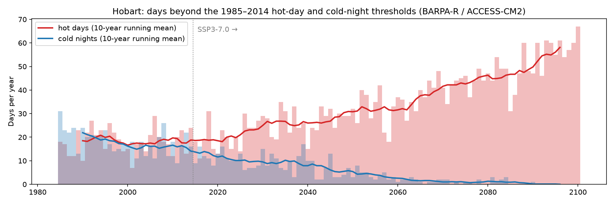
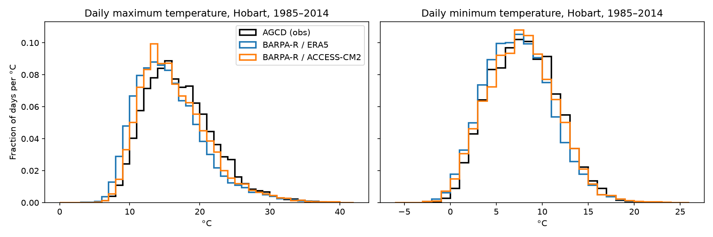
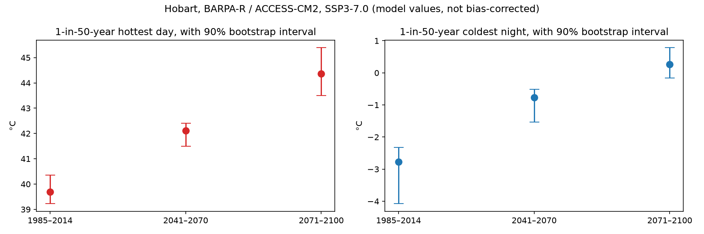
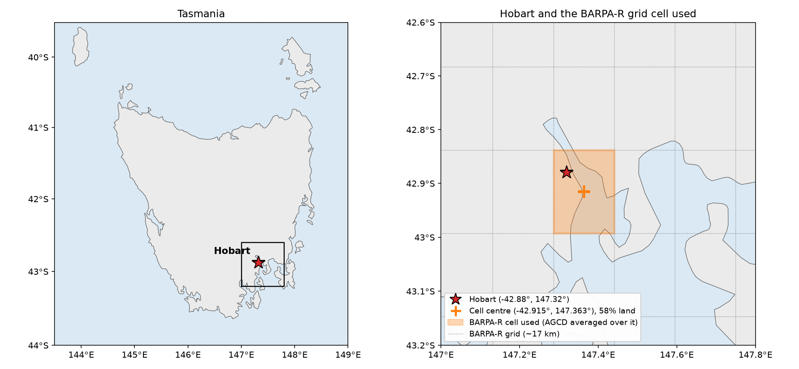

# Hobart temperature extremes under climate change

**How do hot days and cold nights in Hobart, Tasmania, change this century, and how far can one regional climate model be trusted to say so?**

This project follows one 17 km grid cell over Hobart through the Bureau of Meteorology's regional model BARPA-R, driven by the ACCESS-CM2 global model under a high-emissions scenario (SSP3-7.0). It checks the model against observations first, then looks at both ends of the temperature range: daily maximums for heat, daily minimums for cold.



## Headline results

BARPA-R / ACCESS-CM2, SSP3-7.0. Changes are relative to the same model's 1985–2014 climate.

| | 1985–2014 | 2041–2070 | 2071–2100 |
|---|---|---|---|
| Hot days per year (daily max above 25.7 °C, the baseline 95th percentile) | 18 | 33 | 49 |
| Cold nights per year (daily min below 1.9 °C, the baseline 5th percentile) | 18 | 3.6 | 0.6 |
| Change in the 1-in-50-year hottest day | – | +2.4 °C | +4.7 °C |
| How often the baseline 1-in-50-year hottest day recurs | 50 yr | ~3 yr | ~1.6 yr |
| Change in the 1-in-50-year coldest night | – | +2.0 °C | +3.0 °C |

Anchored to observations (the AGCD 1985–2014 value plus the model's change), the 1-in-50-year hottest day goes from **38.5 °C** to about **41.0 °C** by 2041–2070 and **43.2 °C** by 2071–2100. Hobart's highest recorded temperature is 41.8 °C (January 2013).

These numbers come from **one regional model, one driving model and one scenario**. They describe a climate hazard, not a forecast or risk to any asset or population. See [Limitations](#limitations).

## Does the model get Hobart's present climate right?

Compared with AGCD observations for 1985–2014, BARPA-R is slightly cool on average (−0.7 °C for daily maximums when driven by ACCESS-CM2, −1.4 °C when driven by ERA5). Its coldest nights are about 1 °C too cold. Its hottest days are about right when driven by ERA5 and 1 °C too warm when driven by ACCESS-CM2. That is close enough to use the model's *changes*, but its absolute extremes need anchoring to observations, which the notebook does.





## Repository layout

```
scripts/fetch_hobart.py                 pulls the Hobart grid cell from NCI THREDDS into data/
data/                                   the extracted daily series (small, committed)
notebooks/hobart_temperature_extremes.ipynb   location map, evaluation, frequency, extremes, figures
figures/                                written by the notebook
```

## Reproduce

```bash
conda env create -f environment.yml
conda activate hobart-climate-risk
python scripts/fetch_hobart.py      # optional: data/ is already included; takes ~5 minutes
jupyter lab notebooks/hobart_temperature_extremes.ipynb
```

`fetch_hobart.py` skips files that already exist. Delete a file in `data/` to fetch it again.

## Data

All data are read from NCI's public THREDDS server (no account needed), one grid cell at a time.

| File | Source |
|---|---|
| `hobart_barpa-r_era5_evaluation_1985-2014.nc` | BARPA-R v1-r1, AUS-15, driven by ERA5 (evaluation), version v20240801 |
| `hobart_barpa-r_access-cm2_historical_1985-2014.nc` | BARPA-R v1-r1, AUS-15, driven by ACCESS-CM2 r4i1p1f1 historical, v20231001 |
| `hobart_barpa-r_access-cm2_ssp370_2015-2100.nc` | as above, SSP3-7.0 |
| `hobart_agcd_1985-2014.nc` | AGCD v1.0.3 daily tmax/tmin, 0.05°, averaged over the land points inside the BARPA-R cell |



Each file holds `tasmax` and `tasmin` in °C. The BARPA-R cell is centred at 42.915° S, 147.364° E. It is the cell nearest Hobart with at least half its area on land (58%, by BARPA-R's own land fraction). The cell coordinates are stored in each file's attributes.

BARPA and AGCD are published by the Bureau of Meteorology under Creative Commons Attribution 4.0. Please cite them if you reuse the data (NCI's catalogue pages for datasets `py18` and `zv2` give the current preferred citations):

* Howard, E. et al. (2024). *The Bureau of Meteorology Atmospheric Regional Projections for Australia (BARPA): model description and evaluation.* Bureau Research Report.
* Jones, D. A., Wang, W. and Fawcett, R. (2009). High-quality spatial climate data-sets for Australia. *Australian Meteorological and Oceanographic Journal*, 58, 233–248 (the method behind AGCD temperature).

## Method in brief

* **Like with like.** Climate change is measured as ACCESS-CM2 future against ACCESS-CM2 historical, so the difference between driving models is not mistaken for warming. The ERA5-driven run is used only to evaluate BARPA-R itself.
* **Equal 30-year windows.** 1985–2014 baseline, 2041–2070 and 2071–2100.
* **Frequency.** Days per year above the baseline 95th percentile of daily maximum, and below the 5th percentile of daily minimum. Thresholds are held fixed.
* **Magnitude.** A stationary GEV fitted to each window's annual hottest day and (negated) coldest night, giving 1-in-50-year levels with a 90% bootstrap interval over years.
* **Observation anchoring.** The delta method: the AGCD 1985–2014 50-year level plus the model's change.

## Limitations

* **A single storyline.** BARPA-R has seven driving models; this uses one (ACCESS-CM2, one member). The spread across models is likely larger than the bootstrap intervals shown here.
* **One 17 km cell** 
* **Stationary GEV within each window**, 
* **Fixed annual-percentile thresholds** 
* **The delta method** assumes the model's bias at the extremes stays constant. Quantile mapping against AGCD is the natural next step.

## Related work

[australia-heat-hazard-cmip6](https://github.com/dayansunny/australia-heat-hazard-cmip6) covers heat hazard across mainland Australia (CESM2) and Tasmania (BARPA-R / CESM2). This repository goes down to a single city and adds cold extremes.

## Licence

Code: MIT (see [LICENSE](LICENSE)). Data: see [Data](#data).
